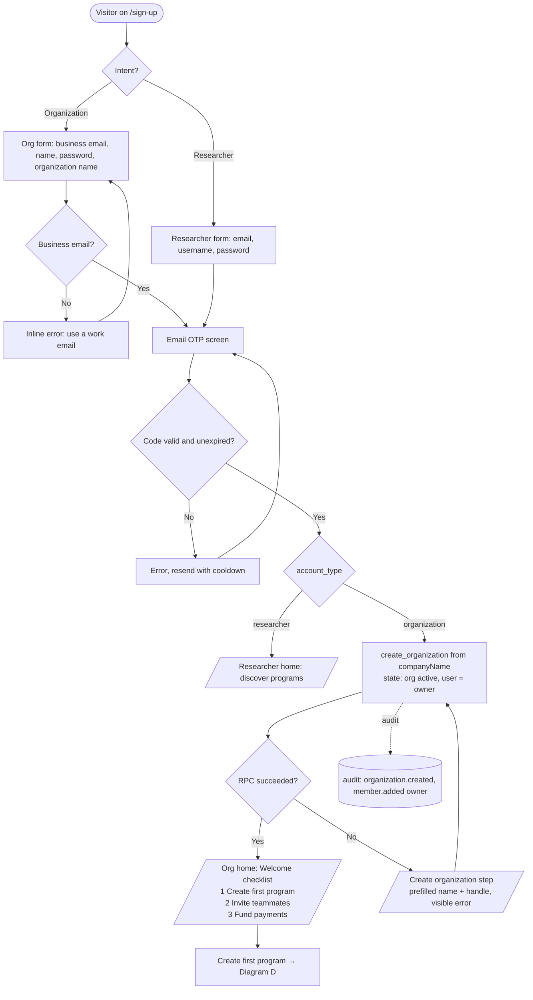
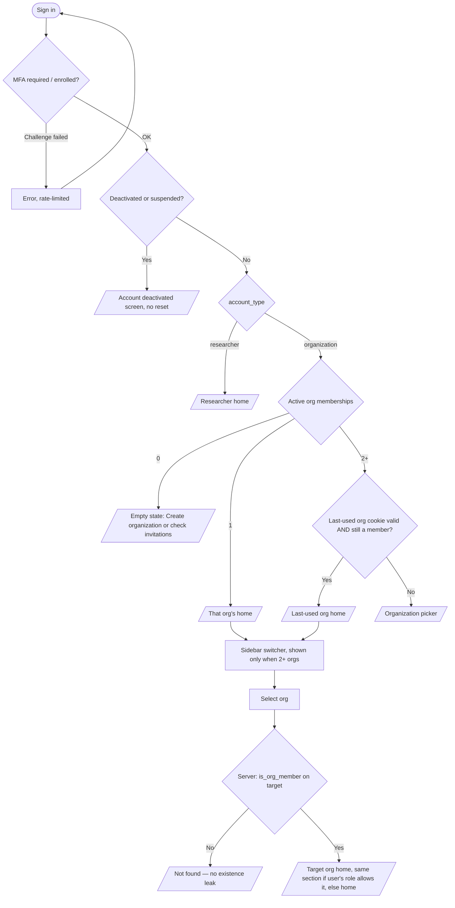
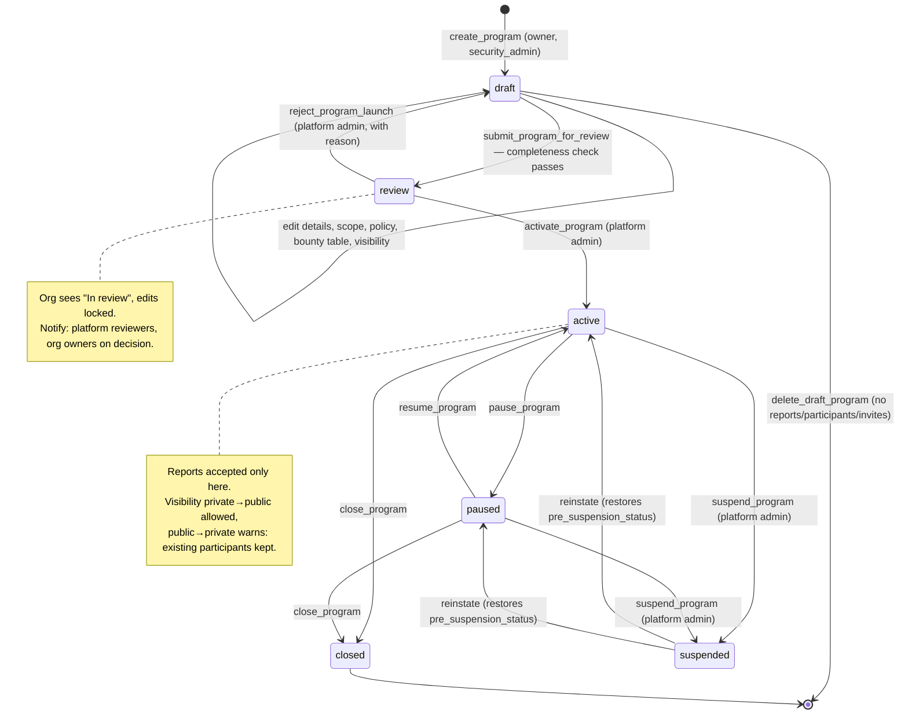
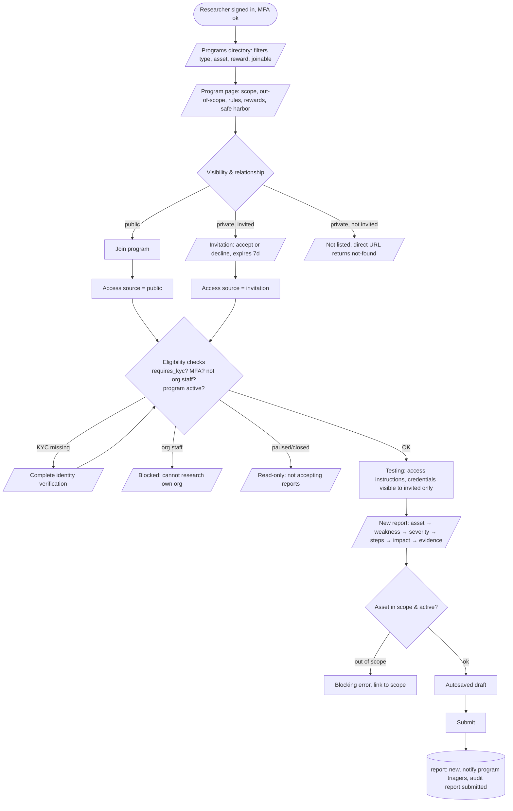
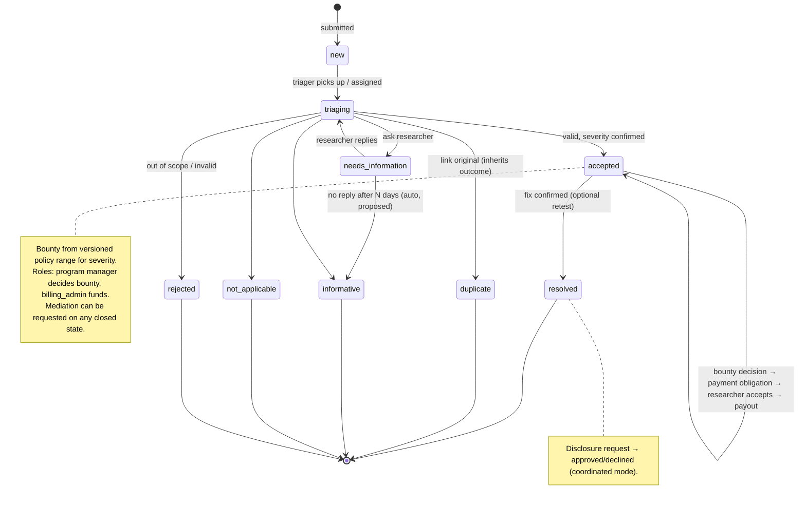
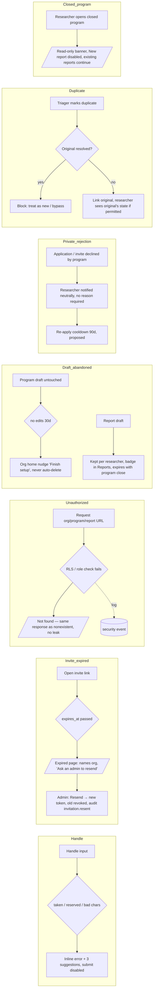

# Competitor Workflow Research & Organization IA

Research date: 2026-10-10. Scope: HackerOne (H1), Bugcrowd (BC), YesWeHack (YWH), Intigriti, Cobalt.

How to read this document:

- **Verified** sections hold only claims taken from official docs, help centers, or official blogs, each with its source URL. Claims that come only from a vendor blog are marked *(blog)*. Claims we could not confirm are marked **[UNVERIFIED]**. Where two sources disagree, the conflict is shown.
- **Unpatched today** sections describe the current codebase, with file paths.
- **Recommendation** sections are design judgment. They are not competitor fact.

---

## 0. Executive summary

1. **Keep `User → Organization → Programs → Reports`.** This is the dominant model in the category. H1, YWH (where the org level is called a Business Unit) and Intigriti (Company) all use it. It is also what Unpatched's database and routes already implement.
2. **Rename "Engagements" back to "Programs" in the org UI.** The org nav says "Engagements". The database, the routes, the researcher UI and the platform-admin UI all say "program". One record carrying two names in one product is a defect. The ADR cited for the rename (`docs/decisions/0076-…`) does not exist. "Engagement" is only a distinct entity at BC (Security Program → Engagement) and, in effect, at Cobalt (Asset → Pentest). In both cases it means a **time-boxed run with its own roster, schedule and deliverable**, on top of reusable configuration. Unpatched has no such object today, so it should not use the word yet. See §3.2.
3. **Unpatched already matches or exceeds the category** on several points:
   - a program lifecycle with a platform review gate (`draft → review → active → paused → closed`), matching H1's "Submit for approval" and Cobalt's "In Review";
   - invitation expiry;
   - append-only audit logging;
   - row-level security (RLS) with composite-FK tenant isolation;
   - versioned bounty policies;
   - retests, mediation and disclosure.
4. **The real gaps are friction and messaging, not new features:**
   - org auto-creation at signup fails silently;
   - a new org owner lands on the Members page instead of "create your first program";
   - invitations send no notifications and have no resend or extend action;
   - the org handle can't be seen or edited at creation;
   - private programs have no application path;
   - `DOMAIN.md` is out of date.
5. **Do not build yet:**
   - a separate Engagement entity;
   - multi-Business-Unit hierarchies;
   - SSO/SCIM;
   - an algorithmic invite engine (H1's daily volume-target system or BC's CrowdMatch);
   - a credit-stake submission system like YWH's.

---

## 1. Researcher workflows — verified competitor facts

### 1.1 Terminology

| Concept | H1 | BC | YWH | Intigriti | Cobalt |
|---|---|---|---|---|---|
| Researcher | Hacker | Researcher | Hunter | Researcher | Pentester (Cobalt Core) |
| Program page | Program / policy | **Brief** (with a Teaser) | Program | Program | Pentest |
| Submission | Report | Submission | Report | Submission | **Finding** |
| Severity | CVSS 3.0/3.1/4.0 | **VRT P1–P5** | CVSS + reward grid | CVSS v3 / 4.0 | OWASP Likelihood × Impact |
| Public feed | Hacktivity | CrowdStream | Hacktivity | — | — (Hall of Fame) |

### 1.2 Registration, MFA, identity

- **H1**
  - Accounts use pseudonymous usernames, a password of at least 12 characters checked by zxcvbn, and email confirmation. https://docs.hackerone.com/hackers/create-an-account.html
  - Every hacker gets a `username@wearehackerone.com` alias. https://github.com/Hacker0x01/docs.hackerone.com/blob/master/docs/hackers/hacker-email-alias.md
  - 2FA has been mandatory for non-SSO users since 2025-07-29. https://docs.hackerone.com/en/articles/8505330-two-factor-authentication
  - Payment setup has three steps: Veriff ID verification (valid 12 months), a payout method, then a tax form. https://docs.hackerone.com/en/articles/8395706-receiving-payments
  - **[UNVERIFIED, secondary sources only]** ID verification became mandatory for bug-bounty submissions on 2026-08-14.
- **BC**
  - 2FA is mandatory for researchers. https://docs.bugcrowd.com/researchers/managing-account/security/using-two-factor-authentication
  - Jumio ID plus a face check is required before submitting to Managed Bug Bounty programs; On-Demand programs are exempt. https://docs.bugcrowd.com/researchers/managing-account/account-settings/verifying-your-identity/
  - Payouts require a W-9 or W-8BEN tax form. https://docs.bugcrowd.com/researchers/payments/setting-up-payment-methods/
- **YWH**
  - Activation is by email. The Code of Conduct must be accepted. TOTP is optional but required for "Secured" programs. https://helpcenter.yeswehack.io/en/articles/376656-sign-up-on-yeswehack
  - **KYC through MangoPay is required before any bug-bounty report, and before private invitations.** https://helpcenter.yeswehack.io/en/articles/586823-submit-a-vulnerability-report · https://helpcenter.yeswehack.io/en/articles/608026-how-to-become-a-yeswehack-hunter
- **Intigriti**
  - 2FA is optional, but programs can require it. The program's sign-up alias is `@intigriti.me`. http://kb.intigriti.com/en/articles/5412984-understanding-testing-requirements
  - The Onfido ID check is required for payouts and unlocks more programs. http://kb.intigriti.com/en/articles/5378971-id-verification-process
- **Cobalt**
  - Cobalt Core is a vetted freelancer pool, not an open crowd.
  - Joining takes five manual stages: application, skills test, interview, verification (background check, tax documents, NDA), and ongoing evaluation. https://www.cobalt.io/life/become-a-pentester · https://www.cobalt.io/faq/about-the-pentesters
  - Pentesters are paid for time, not per vulnerability.

**Pattern.** MFA for researchers is now mandatory at the two largest platforms. Identity verification is gated by the payout, by the program type, or both.

### 1.3 Discovery & access (public vs private)

| | Public | Private | Middle tier |
|---|---|---|---|
| H1 | Directory and Opportunity discovery, with filters for type, asset and industry, plus bookmarks. https://docs.hackerone.com/hackers/opportunity-discovery.html | **Algorithmic invites** [auto]: each program is checked daily against a 30-day volume target. Manual invites are also possible. Invites **expire after 14 days**. **Asking a program for an invite is prohibited.** https://docs.hackerone.com/hackers/invitations.html | — |
| BC | Engagements page with filters, including a **"Joinable"** filter and full/partial Safe Harbor. https://docs.bugcrowd.com/researchers/participating-in-program/finding-program/filtering-programs | **CrowdMatch** [auto] uses skill fit and 90-day activity. Flow: Teaser → Accept → Brief. Invites expire after 8 days *(blog, may be outdated)*. https://docs.bugcrowd.com/researchers/invites/viewing-and-accepting-engagement-invitations/ | — |
| YWH | Open to all verified hunters | Invite-only and requires KYC. Criteria are **[UNVERIFIED]**. | — |
| Intigriti | Public | Invite-only, chosen on activity, quality, reputation, ID and country | **Application** (description and bounty visible; apply with a motivation of up to 500 characters) and **Registered** (visible after registration, optionally ID-gated). http://kb.intigriti.com/en/articles/5379084-program-details-including-private-programs · http://kb.intigriti.com/en/articles/5379029-applying-for-application-programs |
| Cobalt | n/a | The platform matches pentesters to the customer's tech stack; customers may request specific pentesters | — |

Testing provisioning is conditional on the program in every case:

- **VPN:** H1 Gateway, YWH OpenVPN (its routes update as you join programs).
- **Credentials:** H1 "Show Credentials", one set per hacker.
- **Required User-Agent or headers:** YWH, Intigriti.

Sources: https://docs.hackerone.com/en/articles/8536633-hackerone-gateway · https://docs.hackerone.com/hackers/credentials.html · https://helpcenter.yeswehack.io/en/articles/376672-yeswehack-vpn-user-agent

### 1.4 Scope & eligibility enforcement at submit time

- **H1** sets two flags on each asset:
  - **Eligible for submission.** If off, the form shows a red warning and the report is blocked.
  - **Eligible for bounty.** If off, the form warns, but the report is allowed.
  - Each asset also has a maximum CIA impact that caps severity. https://docs.hackerone.com/en/articles/8494552-defining-scope
- **BC** deducts −1 point for submitting against an out-of-scope target. https://docs.bugcrowd.com/researchers/reporting-managing-submissions/reporting-a-bug/
- **Intigriti** runs a scope assistant on the form that shows "Clear to submit" or "Potential scope issue". http://kb.intigriti.com/en/articles/5379086-how-to-write-and-submit-a-good-report
- **YWH** blocks submission when the hunter has no KYC, the program is disabled, or the hunter has too few credits. (Same URL as §1.2.)

### 1.5 Submission

- **H1:** asset → weakness (CWE) → severity (optional unless the program requires it) → proof of concept → attachments. https://docs.hackerone.com/hackers/submitting-reports.html
- **BC:**
  - Fields: Title, Target, VRT, URL, and a description template with four sections.
  - **Drafts autosave every 30 seconds.** Triage can't see drafts.
  - **Submissions can't be edited after they are submitted.**
  - A Collaborate option splits the reward.
  - Source: same URL as §1.4.
- **Intigriti:**
  - Starts as a draft.
  - Fields: Title, Asset, Endpoint, Type, Severity, PoC, Impact, Recommended fix, and the tester's IP address.

### 1.6 Triage, duplicates, communication

| | Who triages | States |
|---|---|---|
| H1 | AI "Agentic Validation", then human analysts (managed programs), then the program | Open: New, Pending Program Review, Triaged, Retesting, Needs More Info. Closed: Resolved, Informative, Duplicate, Not Applicable, Spam. Needs More Info **auto-closes as Informative after 30 days**. https://docs.hackerone.com/en/articles/8475030-report-states · https://docs.hackerone.com/en/articles/8837878-how-triage-works |
| BC | BC Application Security Engineer (ASE), then the program | New → Triaged → **Accepted**: Unresolved / Resolved / Informational, or **Rejected**: Out of Scope / Not Reproducible / Not Applicable. https://docs.bugcrowd.com/customers/submission-management/submission-status |
| YWH | YWH triage (24/7) or the customer's own team | New, Under Review, NMI, Accepted, Resolved, Not Valid. A parallel triage track: In progress / Awaiting info / **Assessed** / Done. https://helpcenter.yeswehack.io/en/articles/376669-vulnerability-reports-workflow |
| Intigriti | Intigriti triage (managed), then the company | Draft → Triage → **Pending** → Accepted → Closed → Archived. Each close has a **required close reason**: Accepted risk, Duplicate, Informative, Out of Scope, N/A, Spam. https://kb.intigriti.com/en/articles/3379382-submission-states-close-reasons |
| Cobalt | Pentesters validate their own findings | Triaging, Pending Fix, **Ready for Retest**, Fixed, Accepted Risk, **Carried Over**, Declined, Out of Scope, Duplicate. https://docs.cobalt.io/articles/finding-states-De6IE4W5Zw |

**Duplicate rule shared across BC and YWH:** a duplicate must link to its original and inherits the original's final state. A report cannot be marked a duplicate of a **Resolved** original, because a bypass of the fix counts as a new finding. (Same sources as the table.)

**Mediation and escalation:**

- H1 has "Request Mediation" (requires Signal > 0). https://docs.hackerone.com/hackers/hacker-mediation.html
- BC has "Request a Response", suggested after 7 business days *(blog)*.
- Intigriti has a mediation team.

### 1.7 Bounty, payment, retest, closure, disclosure

- **H1 award types:** Bounty (can be split or donated), Bonus and Swag. Payouts run on a schedule (daily, monthly, or once a threshold is reached). https://docs.hackerone.com/en/articles/8395706-receiving-payments
- **H1 retests:** by invitation. The suggested fee is $50–500, and a retest earns +2 reputation. https://docs.hackerone.com/hackers/retesting.html
- **H1 disclosure:** by mutual agreement. A Resolved report auto-discloses after 30 days if the program doesn't respond. https://docs.hackerone.com/hackers/disclosure.html
- **BC rewards:** the owner clicks "Add Reward". The amount comes out of the reward pool and can't be edited after Pay. https://docs.bugcrowd.com/customers/submission-management/rewarding/
- **Intigriti payouts:** created automatically when a submission is accepted. Payout states are Error, Pending, Processing, Paid and Failed; Error means the ID check or payout method is missing. Retests are offered to the original reporter with a bounty and a deadline. http://kb.intigriti.com/en/articles/3379564-payout-lifecycle · http://kb.intigriti.com/en/articles/9465242-retesting-submissions
- **YWH payouts:** bounties go to an e-wallet and a monthly self-billing invoice is generated. https://helpcenter.yeswehack.io/en/articles/376650-rewards-billing-withdrawals

### 1.8 Reputation

- **H1:**
  - Reputation points by outcome: Resolved +7, Informative 0, N/A −5, Spam −10.
  - **Signal** = average reputation per report. **Impact** = average reputation per bounty.
  - The 90-day leaderboard ranks by Reputation × Signal percentile × Impact percentile.
  - https://docs.hackerone.com/hackers/signal-and-impact.html · https://docs.hackerone.com/hackers/90-day-leaderboard.html
- **BC:**
  - Kudos points by priority: P1 40, P2 20, P3 10, P4 5.
  - Performance stats: accuracy, priority percentile, rank.
  - **Conflict:** "Accuracy" may have been replaced by "Acceptance Rate".
  - https://docs.bugcrowd.com/researchers/receiving-rewards/getting-rewarded/
- **YWH:**
  - Accepted +7.
  - A duplicate earns 25% of the original's points.
  - Need More Info −1.
  - Bonus points for correct CVSS and report quality.
  - https://helpcenter.yeswehack.io/en/articles/376433-leaderboard
- **Intigriti:**
  - Points by severity: 5 / 20 / 25 / 40 / 50.
  - A duplicate earns 20%.
  - **Streak** = the highest severity accepted in the last 90 days.
  - http://kb.intigriti.com/en/articles/3379630-understand-your-ranking-leaderboard-reputation-and-streaks

---

## 2. Organization workflows — verified competitor facts

### 2.1 Hierarchy and terminology (the key finding)

| Platform | Hierarchy | "Engagement"? |
|---|---|---|
| **H1** | Organization → Program. Each program has an engagement type: Bounty, Response, Pentest, Challenge or Campaign. A Campaign "runs on top of a bounty program." https://docs.hackerone.com/en/articles/8485885-engagements | Used as an **umbrella label for program types**, not as a separate level |
| **BC** | Organization → **Security Program** ("the container for a set of targets, submissions, and settings") → **Engagement(s)**, which inherit most of the program's configuration. https://docs.bugcrowd.com/customers/engagement-management/engagement-overview-page/ | **A distinct child entity.** BC did *not* rename programs to engagements; the brief's premise was wrong. |
| **YWH** | **Business Unit** → Program (bug bounty, pentest or VDP) → Report. https://helpcenter.yeswehack.io/role-matrix | None |
| **Intigriti** | **Company** → Program → Submission. https://kb.intigriti.com/en/articles/8825397-user-roles-permissions | None. Pentesting as a Service (PtaaS) is marketed separately; how it is modeled is **[UNVERIFIED]** |
| **Cobalt** | Organization → **Asset** → **Pentest** (one asset per pentest, many pentests per asset) → Finding. https://docs.cobalt.io/articles/assets-are-what-we-pentest-09RgsvQ7zv.md | The pentest *is* the time-boxed engagement. There is no program concept. |

### 2.2 Signup and onboarding model

- **H1** is sales-led and product-specific. Response (the VDP product) has a self-serve setup guide (see §2.5). Whether H1 Response is free is **[UNVERIFIED]**. https://docs.hackerone.com/en/articles/8365279-product-offerings
- **BC** is partly self-serve. The On-Demand wizard produces a program that BC then contacts the customer to review and launch. The minimum reward pool is $15k. https://docs.bugcrowd.com/customers/program-management/adding-new-engagements/adding-on-demand-program
- **YWH** is **self-serve**:
  - Register → "Register a new company" → confirm email → accept the terms → Manager view → complete company and billing information. Billing must be complete before a wallet or program can be set up.
  - **The currency can never be changed.**
  - One account switches between a Manager view and a Hunter view.
  - https://helpcenter.yeswehack.io/en/articles/369765-company-set-up
- **Intigriti** is sales-led. The Company Admin is assigned during onboarding.
- **Cobalt** is sales-led. Users join by invitation, and the customer buys credits (1 credit = 8 pentester-hours). https://docs.cobalt.io/credits
- **Org handle and URL rules are undocumented at every platform** **[UNVERIFIED]**. The one exception is YWH: the program title becomes its URL slug and can't be changed without an admin. https://helpcenter.yeswehack.io/en/articles/376644-bug-bounty-program-creation

### 2.3 Roles — every platform uses two tiers

| Platform | Org tier | Program tier |
|---|---|---|
| H1 | Admin, Member, plus custom group permissions (User manager, Groups manager, Assets manager). **Only Admins see the audit log.** https://docs.hackerone.com/en/articles/9095492-permissions | Admin and Standard by default. Custom groups get Read-only, Program admin, Rewards or Report permissions. https://docs.hackerone.com/en/articles/8490814-groups-and-permissions |
| BC | Owner, Member (**sees nothing until given a program role**), User Admin. **Only the Owner can create programs.** https://docs.bugcrowd.com/customers/role-and-permissions/understanding-roles-and-permissions/ | Program Administrator, Analyst (can't reward), Viewer |
| YWH | **Business Unit Owner (exactly one, cannot be revoked by a Manager)**, Business Unit Manager (several), Surface Manager, Accounting Manager. https://helpcenter.yeswehack.io/en/articles/608724-business-unit-owner-manager-roles-buo-bum | Program Manager (can edit but not create), Viewer, Analyst, Auditor (can't reward), Report Viewer |
| Intigriti | Company Admin, Company Member (no program access by default) | Program Admin, Editor, Member, Reader |
| Cobalt | Owner, Member (scoped by Groups) | Pentest Team Member (one pentest only). https://docs.cobalt.io/collaboration/user-roles |

**Invites:**

- YWH lets you invite by username or email, and the invitee doesn't need an account yet. Invites show as pending, accepted or revoked. https://helpcenter.yeswehack.io/en/articles/376513-invite-your-team-on-yeswehack
- At Intigriti, expired invites can be resent from Admin. Members are **deactivated, never deleted**. The 24-hour expiry it mentions is ambiguous: it may cover all invites or only SSO setup. https://kb.intigriti.com/en/articles/6299393-user-access-authentication-management
- Team-invite expiry is **[UNVERIFIED]** at H1, BC, YWH and Cobalt.

**Multiple orgs:**

- Cobalt has an org picker in the top-left corner. https://docs.cobalt.io/organization/manage-users
- BC has a help page titled "Switching Between Multiple Organizations"; only the title was seen.
- At YWH, using several business units is **[UNVERIFIED]**.

### 2.4 SSO and MFA (enterprise)

- **H1:** SAML with just-in-time (JIT) provisioning. SSO and 2FA are mutually exclusive login methods. https://docs.hackerone.com/organizations/sso-jit.html
- **BC:** only the Owner can set up SSO, and all domains must be verified first. https://docs.bugcrowd.com/customers/single-sign-on/sso-overview/
- **YWH:** domain verification by an HTTP file, a meta tag or a DNS record. https://helpcenter.yeswehack.io/en/articles/376657-single-sign-on-configuration-sso
- **Cobalt:** an "Enforce SAML" setting. https://docs.cobalt.io/articles/configure-saml-sso-oT8Q3qO09D.md

### 2.5 Program creation, review and lifecycle

- **H1 Response setup:**
  1. Program Setup, then "**Submit for approval**".
  2. **Controlled Launch** (private).
  3. **Public Launch**. This unlocks only after at least 10 reports, 100 invited hackers, and meeting the response targets.
  - "All programs begin as private." https://docs.hackerone.com/en/articles/8509950-response-program-setup · https://docs.hackerone.com/en/articles/8368948-private-vs-public-programs
- **H1 pause:**
  - Submissions can be paused entirely or limited to critical reports only.
  - **A program can't resume while it has reports breaching their SLAs.**
  - H1 itself can pause a program for missed SLAs.
  - https://docs.hackerone.com/en/articles/8499776-pausing-report-submissions
- **H1 response targets:** time to first response, triage, bounty and resolution, measured in business days. https://docs.hackerone.com/organizations/response-target-metrics.html
- **BC:**
  - On-Demand wizard steps: Name → Targets → Terms (defaults: VRT, safe harbor, coordinated disclosure) → Reward pool → Concerns → Crowd → Look & feel → Schedule → Review.
  - Engagement states: Draft (the only deletable state), Launching, Launch paused, In progress, In progress-paused, Finalizing, Completed, Canceling, Canceled. https://docs.bugcrowd.com/customers/engagement-states/
- **YWH:**
  - Program sections: Details → Configuration (State **disabled by default**; Visibility) → SLAs → Hunting requirements → Scopes with an asset value → Qualifying and non-qualifying vulnerabilities → Reward grid (plus a "Systemic Issues" grid) → Policy → Preview.
  - **Programs can't be deleted, only archived.** Many fields need CSM approval to change after saving.
  - https://helpcenter.yeswehack.io/en/articles/376644-bug-bounty-program-creation
- **Intigriti:**
  - States: Draft (researchers can be pre-invited) → Open → **Suspended** (set manually or automatically when the budget runs out) → **Closing** (wind-down while pending submissions are handled) → Closed (reached automatically). https://kb.intigriti.com/en/articles/3379312-program-states
  - Confidentiality levels: Invite only, Application, Registered, Public, Unlisted. https://kb.intigriti.com/en/articles/13175939-program-confidentiality-levels
- **Cobalt:** Draft → **In Review** → Planned → Live → Remediation → Closed, plus Paused and Cancelled. https://docs.cobalt.io/pentests/pentest-states

### 2.6 Payments, integrations, notifications, audit

- **Funding:**
  - H1: prepayment plus a credit card. Awards and fees are deducted from the balance, with low-balance alerts. https://docs.hackerone.com/organizations/billing.html
  - BC: a reward pool.
  - YWH: a prepaid Wallet, refilled by purchase order, with a low-balance alert. https://helpcenter.yeswehack.io/en/articles/376670-wallet-management
  - Cobalt: credits.
- **Audit:**
  - H1: Admin-only.
  - YWH:
    - Records organization (business unit) events, program events and report events, including reward payments and exports.
    - Exports to CSV, XLS, JSON or PDF.
    - https://helpcenter.yeswehack.io/en/articles/369606-audit-logs
- **Integrations:** Jira is everywhere (Intigriti: one connection per company. https://kb.intigriti.com/en/articles/7930271-jira). YWH also has Slack, webhooks and an API. https://helpcenter.yeswehack.io/en/collections/875291-integrations
- **Notifications:** YWH has in-app notifications (always on) plus email notifications configurable per report event. https://helpcenter.yeswehack.io/en/articles/334933-notification-center

---

## 3. Unpatched information architecture

### 3.1 Unpatched today (from the codebase)

| Area | Current state | Where |
|---|---|---|
| Hierarchy | `users → organizations → programs → reports`. Composite FKs `(program_id, organization_id)` stop records from crossing tenants. | `db/migrations/` |
| Org roles | `owner, security_admin, program_manager, triager, billing_admin`; program roles `manager, triager` | `202608260001_…lifecycle.sql`, `202609250012_organization_role_permissions.sql` |
| Isolation | RLS everywhere. All writes go through `SECURITY DEFINER` RPCs that use `private.is_org_member`, `has_org_role`, `is_program_member`, and others | `docs/decisions/0001-rpc-based-membership-mutations.md` |
| Signup | Organization intent requires a business email. After the email OTP, the app tries to auto-create the org from `companyName`, then **redirects to `/members`**. If that fails, the user lands on the default page with no explanation. | [actions/auth.ts:145-150](../../actions/auth.ts#L145-L150) |
| Org handle | The slug is generated on the server (`^[a-z0-9-]{3,63}$`, with a random suffix if it collides). It is never shown as a field and can't be renamed. Routing uses UUIDs. | `202608260003_organization_creation.sql` |
| Multi-org | Supported through the `OrganizationSwitcher`. The current org comes from the URL and is not saved. | `components/app-shell-client.tsx:415` |
| Program lifecycle | `draft → review → active ⇄ paused → closed`. **Only a platform admin can activate.** A rejection returns the program to `draft`. `suspended` is a platform-only state. Only a draft with no activity can be deleted. | `202609050013_program_launch_review_gate.sql`, `202608300001_program_lifecycle_foundation.sql` |
| Visibility | `private`/`public`. Researchers can self-join public programs; private programs are invite-only. **There is no access-request path.** | `202608260006_researcher_access_foundation.sql` |
| Invitations | Org and program invites are stored as SHA-256 token hashes and **expire after 7 days**. Only one invite can be pending per email. **No invitation notifications are sent, and invites can't be resent or extended.** | same |
| Report states | `new, triaging, needs_information, accepted, resolved, duplicate, informative, not_applicable, rejected`, with transitions defined in a table | `202608270001` |
| Naming | DB, routes, researcher UI and platform UI say "program". **The org UI says "Engagements".** | [components/app-shell-client.tsx:183](../../components/app-shell-client.tsx#L183) |
| `engagement_type` | `bug_bounty, response, pentest, code_audit, challenge, campaign, spot_check`. Set once at creation; used only for grouping and changes no behavior. | `202609070002_engagement_type.sql` |

### 3.2 Decision: "Engagements" → "Programs"

**Recommendation: rename the org-side UI label to "Programs" now. Rename the `engagement_type` concept to "Program type".**

Reasons:

1. In Unpatched, the thing the org UI calls an "Engagement" *is* a program: same table, same routes, same lifecycle. The researcher sees "Program" for the same record. When the same object has two names, users stop trusting the product. It also breaks one of our own rules: the same record must never appear under two identities.
2. The verified category usage doesn't support "Engagement" as a synonym. H1 uses it as a *type label* on programs. BC uses it for a *child* of a Security Program. YWH and Intigriti don't use it at all.
3. "Program" is the word researchers already know from every platform.

**When an Engagement should be a separate entity.** Add it only when *all* of the following become true. This is BC's Security Program → Engagement model, and Cobalt's Asset → Pentest model.

- One program needs **several time-boxed runs** against the same scope, policy and asset inventory. Examples: a quarterly pentest, a two-week campaign with bonus multipliers, a live-hacking event.
- Each run has **its own schedule** (start and end dates), **its own researcher roster**, **its own budget or reward modifier**, and **its own deliverable** (a pentest report, a campaign summary).
- Each run's **reports must be attributable to it** while still rolling up to the program's history and duplicate checking.

At that point, the model becomes:

`Program (scope, policy, bounty table, history) 1──* Engagement (type, window, roster, budget, status) 1──* Report`

`engagement_type` would move onto that new table. Until then, the existing `engagement_type` column is a **program type** and should be labelled that way. Note that its values `campaign` and `challenge` describe exactly the kind of run that would justify a real Engagement later.

### 3.3 Recommended IA

```
User account (one login; account_type: researcher | organization — kept strictly separate)
└── Organization (default one, created at onboarding; optional more)
    ├── Home            (summary only — links out, never embeds other lists)
    ├── Programs        (list + type filter)  ← was "Engagements"
    │   └── Program
    │       ├── Inbox / Reports / Scope / Policy & rewards / Researchers / Settings   (program-level sub-nav)
    │       └── Report
    ├── Findings        (cross-program report view)
    ├── Assets          (org asset inventory, reused across program scopes)
    ├── Researchers     (org-wide relationships)
    ├── Payments
    ├── Analytics
    ├── Activity        (audit log)
    ├── Members         (roles, invitations)
    └── Settings        (profile, handle, defaults)
```

Rules:

- The org switcher sits at the top of the sidebar and appears **only when the user has two or more orgs**. A single-org user never sees the multi-org concept.
- "Create organization" lives inside the switcher menu, not in onboarding.
- The org nav is the single navigation control for the org level. The program sub-nav must not repeat any org-level destination.

---

## 4. Workflow diagrams

### A. First-time account and organization onboarding



### B. Returning user and organization switching



### C. Organization creation and membership

```mermaid
flowchart TD
  subgraph Create
    A([Switcher → Create organization]) --> F[Form: name, handle auto-suggested from name]
    F --> HV{Handle valid?<br/>3–63, a–z 0–9 hyphen,<br/>no edge hyphen, not reserved, unique}
    HV -- No --> HE[Inline error + suggestion] --> F
    HV -- Yes --> AT{account_type = organization?}
    AT -- No --> X[/Blocked: researcher accounts cannot own orgs/]
    AT -- Yes --> OK[Org created, creator = owner] --> AUD[(audit organization.created)]
  end
  subgraph Invite
    OW([Owner / security_admin on Members]) --> IV[Invite: email, role]
    IV --> DUP{Pending unexpired invite or active member?}
    DUP -- Yes --> DE[Inline: already invited, offer Resend] 
    DUP -- No --> TK[Token hash stored, expires 7d<br/>email + in-app notification] --> AUD2[(audit invitation.created)]
    TK --> RCV([Invitee opens link])
    RCV --> ST{Token state}
    ST -- expired --> EX[/Expired screen: ask an admin to resend/]
    ST -- revoked --> RV[/Invitation no longer valid/]
    ST -- valid --> AC{Signed in as invited email?}
    AC -- No account --> SU[Sign up with email locked] --> JN
    AC -- Different email --> WE[/Wrong account: sign out & switch/]
    AC -- Yes --> JN[Accept → membership active with role] --> AUD3[(audit member.joined, notify inviter)]
  end
  subgraph Manage
    M([Owner]) --> RC[Change role / suspend / remove]
    RC --> LO{Would leave org with no active owner?}
    LO -- Yes --> BL[/Blocked: transfer ownership first/]
    LO -- No --> DONE[Applied, program assignments follow role] --> AUD4[(audit member.role_changed)]
  end
```



### D. Organization → program creation → publication



### E. Researcher discovery → access → testing → submission



### F. Submission triage → bounty decision → remediation → closure



### G. Exceptional paths



---

## 5. Implementation-ready specs

These are recommendations. Each spec lists only what changes or is missing; anything already built is noted in brackets.

### 5.A Onboarding (first-time org)

- **Entry and intent:** `/sign-up` with intent = organization. The user wants to "get a program live".
- **Screens:** sign-up form → OTP → org home with a Welcome checklist. The fallback is a "Create organization" step.
- **Fields:**
  - work email (business-domain check, [exists]);
  - full name;
  - password;
  - organization name: 1–160 characters [exists];
  - **handle**: new, optional at sign-up and auto-derived from the name.
- **Changes:**
  1. After the org is created, redirect to **org home**, not `/members`. The checklist shows three items: Create program / Invite team / Payments.
  2. If `create_organization` fails, redirect to `/organizations/new?name=…` with a visible error, instead of the silent default page.
  3. Fix the stale header comment in `actions/auth.ts`. It says any user can create orgs, but a trigger enforces `account_type`.
- **Permissions:** an `account_type='organization'` trigger [exists].
- **Audit and notifications:** `organization.created` and `member.added(owner)`, plus a welcome email.
- **States:**
  - empty: checklist;
  - loading: skeleton on org home;
  - error: retry on the create step.
- **Acceptance criteria:**
  - A new org user lands on their org home with exactly one org.
  - If org creation is forced to fail, the user lands on the create step with the name prefilled.
  - The user never sees an org switcher.

### 5.B Returning user and switching

- **Change:** keep the last-used org in a cookie and treat it only as a preference. The server must re-check `is_org_member` before using it, and it must never act as authorization.
- **Rules:**
  - Show the switcher only when the user has 2 or more orgs.
  - On switch, keep the same section if the user's role in the target org allows it; otherwise go to home.
  - An org the user doesn't belong to returns not-found.
- **Acceptance criteria:**
  - A user in 2 orgs signs out and back in, and returns to the last-used org.
  - If they were removed from that org in the meantime, they land on the picker.

### 5.C Org creation and membership

- **Handle validation (new):**
  - `^[a-z0-9](?:[a-z0-9-]{1,61}[a-z0-9])$`, which is a stricter subset of the DB check.
  - Reserved words: `new, settings, admin, platform, api, programs, unpatched, …`.
  - Live uniqueness check, debounced.
  - The owner can edit it from Settings. Changing it is safe because routing uses UUIDs.
  - The DB needs a matching check plus a `rename_organization`/`set_organization_handle` RPC (owner only, audited).
- **Invitations:**
  - Add **Resend**: revoke the old token, issue a new one, and record `invitation.resent`. Add **Revoke** if it isn't already in the UI.
  - Add notification types `organization_invitation_received` and `program_invitation_received`, and notify the inviter when an invite is accepted.
  - Keep the 7-day expiry. Exposing a custom expiry is low priority.
- **Last owner:** removing or demoting the last owner stays blocked [exists]. Add a "Transfer ownership" action.
- **Acceptance criteria:**
  - An expired link shows the expired screen.
  - Resend kills the old link.
  - A role change appears in Activity.
  - Signing in with the wrong account shows the switch-account screen and creates no membership.

### 5.D Program creation and publication

- **Wizard sections**, based on YWH and BC: Basics (name, program type, description) → Scope (assets in and out, with H1-style **eligible for submission / eligible for bounty** flags) → Rules and policy (safe harbor, disclosure mode, testing requirements: VPN, headers, credentials) → Rewards (versioned bounty table by severity) → Response targets (SLA) → Visibility → Review.
- **Completeness check before `submit_program_for_review`:**
  - at least 1 active in-scope asset;
  - a policy;
  - a bounty table if `type=bounty`;
  - errors listed per section.
- **States:** [exists]. Add an "In review" banner for the org, and a rejection reason shown on the draft.
- **Proposed additions:**
  - "Critical-only" pause mode, as at H1. **Later.**
  - Intigriti's "Closing" wind-down. Unpatched already lets existing reports continue after close, which is equivalent.
- **Audit:** `program.created`, `.submitted`, `.approved`, `.rejected`, `.paused`, `.closed`, `.visibility_changed`.
- **Acceptance criteria:**
  - An incomplete draft can't be submitted, and the specific missing section is shown.
  - A rejected program returns to draft with the reason visible.
  - Only a platform admin can activate.

### 5.E Researcher discovery and submission

- **Exists:** discovery, public join, private invite, the KYC flag, the org-staff block, and drafts.
- **Add:**
  1. An **eligibility panel** on the program page: KYC ✓/✗, MFA ✓/✗, invited/joined. It tells the researcher *why* they can't submit before they start writing.
  2. A hard block on the form for out-of-scope or removed assets, and a warning when the asset is not bounty-eligible.
  3. **Later:** an "Application" visibility level, as at Intigriti. Applicants send a motivation of up to 500 characters; the program accepts or declines; a declined applicant can't re-apply for 90 days. This needs a new `program_access_requests` table with status `pending/approved/declined/withdrawn`, and the same RLS pattern as invitations.
- **Acceptance criteria:**
  - A researcher without KYC on a `requires_kyc` program sees the gap before opening the form.
  - A private program the researcher isn't invited to returns not-found.

### 5.F Triage → bounty → closure

- **Exists:**
  - the status set and the transitions table;
  - assignee;
  - versioned bounty policy;
  - payment obligations, acceptances and payouts;
  - retests, mediation and disclosure.
- **Add:**
  1. Auto-close `needs_information` → `informative` after 30 days with no researcher reply, with a warning at day 23. This follows H1. Run it as a scheduled job, and make sure it carries no reputation penalty.
  2. A duplicate can't point to a `resolved` original; a bypass counts as a new report. This is the BC and YWH rule.
  3. **Later:** a required close reason on `rejected` (out_of_scope / not_reproducible / invalid), as at BC and Intigriti.
- **Acceptance criteria:**
  - Marking a report as a duplicate of a resolved original is rejected by the RPC.
  - The stale needs-information job closes the report and notifies both sides.

### 5.G Exceptional paths

Each path is covered in diagram G. The rule shared by all of them: **authorization failures return not-found and never reveal that a resource exists.**

---

## 6. Prioritized plan

| # | Item | Tier | Now / Later | Size |
|---|---|---|---|---|
| 1 | Rename org UI "Engagements" → "Programs"; label `engagement_type` as "Program type" | Parity / clarity | **Now** | S (copy and nav only) |
| 2 | Onboarding: land on org home with the checklist; replace the silent failure with a visible fallback | Friction | **Now** | S |
| 3 | Invitation notifications plus Resend/Revoke | Parity | **Now** | M |
| 4 | Program review completeness check, plus rejection reason shown on the draft | Parity | **Now** | M |
| 5 | Researcher eligibility panel; out-of-scope block on the report form | Friction / security | **Now** | M |
| 6 | Duplicate-of-resolved guard in the RPC | Security / integrity | **Now** | S |
| 7 | Update `DOMAIN.md` to match the real lifecycle, roles, access and naming | Docs | **Now** | S |
| 8 | Org handle field, validation and owner rename RPC | Parity | Next | M |
| 9 | Last-used org preference (server re-checks membership) | Friction | Next | S |
| 10 | Needs-information auto-close job | Parity | Next | M |
| 11 | Transfer ownership | Security | Next | M |
| 12 | Asset eligible-for-submission / eligible-for-bounty flags | Parity | Next | M |
| 13 | "Application" visibility and access requests | Differentiator | Later | L |
| 14 | Critical-only pause; SLA-breach resume block | Parity+ | Later | M |
| 15 | Engagement entity (time-boxed runs under a program) | Differentiator | Later, only when §3.2's conditions hold | XL |
| — | SSO/SCIM, multiple business units, algorithmic invites, credit stakes | — | **Not now** (enterprise or crowd-scale features with no current demand) | — |

**Security notes that apply to every item:**

- Every new action is a `SECURITY DEFINER` RPC that checks `auth.uid()` and the role, plus an audit row.
- Gates never trust client headers.
- Cross-tenant references use composite FKs.
- Not-found responses never leak whether a resource exists.

---

## 7. Couldn't verify (open research items)

- Organization and program handle rules at every platform. H1 and BC team-invite expiry.
- Whether H1 Response (VDP) is free. Whether H1 ID verification has been mandatory since 2026-08.
- Bugcrowd's sign-up flow, bookmarks, researcher retests and 2FA enforcement for customers.
- YesWeHack's invite criteria, CVSS version, disclosure, multi-Business-Unit switching, and whether newly created programs get platform review.
- Intigriti's self-serve signup, how pentesting is modeled in the admin UI, the scope of its 24-hour invite expiry, and its audit log.
- Cobalt's pentester levels and pay, and its audit log.
